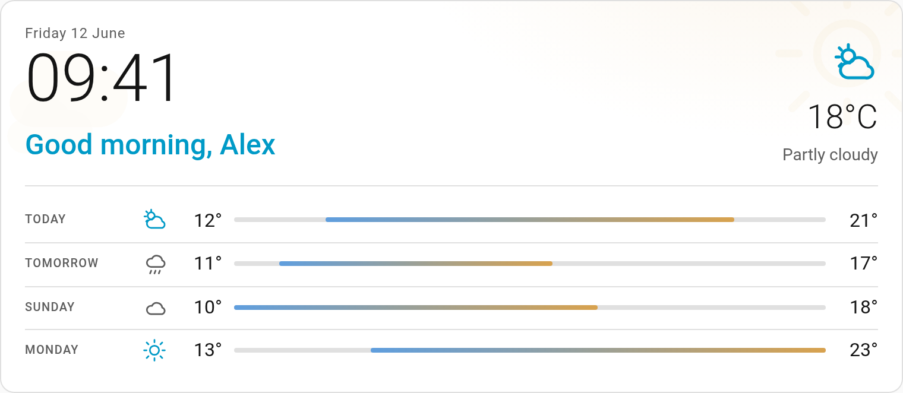
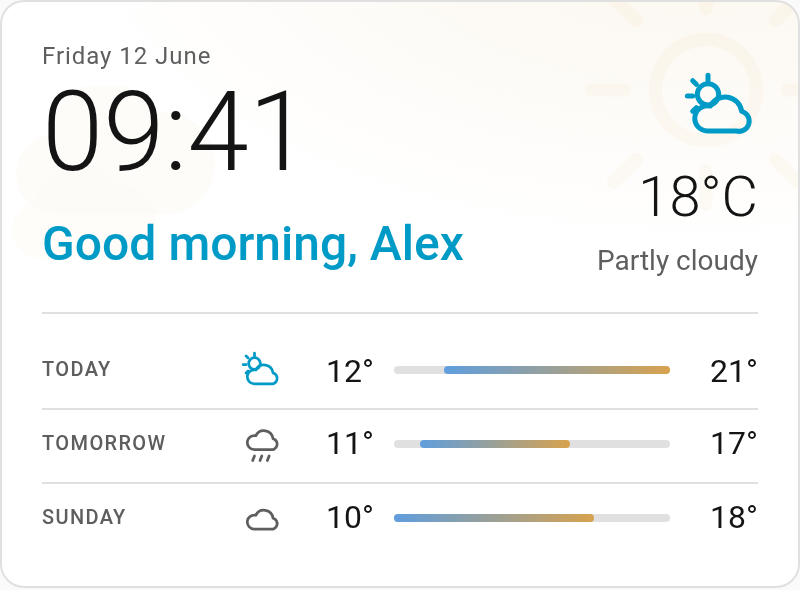

# Home Info Card

[](https://hacs.xyz/docs/faq/custom_repositories/)
[](LICENSE)

The top of a dashboard: date, time, a greeting, the weather now and a few days
ahead, in one card.

<picture>
  <source media="(prefers-color-scheme: dark)" srcset="images/info-card-dark.png">
  
</picture>

It is one card rather than a clock card, a weather card and a markdown card in a
stack, so the type and spacing belong to one design instead of three fighting
each other.

## Installation

### HACS

1. In HACS, open the menu (⋮) > **Custom repositories**.
2. Add `https://github.com/Sandolution/ha-info-card` with the type **Dashboard**.
3. Install **Home Info Card**. HACS adds the dashboard resource for you.
4. Reload the browser.

### Manual

1. Download `home-info-card.js` from this repository into `config/www/`.
2. Add it as a resource: **Settings > Dashboards > ⋮ > Resources**, URL
   `/local/home-info-card.js`, type **JavaScript module**.
3. Reload the browser.

## Configuration

Add it from the dashboard's **Add card** dialog and every option below can be
set in the card editor, except `text`, which is written in the code editor. The
editor keeps whatever it doesn't show.

```yaml
type: custom:home-info-card
entity: weather.home
```

### Options

| Option | Values | Default | What it does |
|---|---|---|---|
| `type` | `custom:home-info-card` | | **Required.** |
| `entity` | a `weather.*` entity | | **Required.** The weather shown on the card. Anything that isn't a `weather.` entity is a configuration error. The forecast rows need an integration that provides a daily forecast. |
| `forecast_days` | a whole number, `1` or more | `3` | Days in the forecast, one row each, starting today. Never more than the weather integration provides. |
| `greeting` | `true` or `false` | `true` | Shows "Good morning, Sam" under the clock, with the first name of whoever is logged in. |
| `greeting_entity` | any entity | none | While this entity's state is something other than `unknown`, `unavailable` or empty, that state is shown instead of the greeting, as it is. Use it for something more pressing than "Good evening", such as a template sensor. |
| `greeting_exclude` | a text, or a list of texts | none | Logins whose user name contains one of these, ignoring case, get the greeting without a name. For a wall tablet with its own login: `greeting_exclude: tablet` keeps it from saying "Good morning, Tablet". |
| `animate` | `true` or `false` | `true` | `false` makes the card completely still. See [Motion](#motion). |
| `text` | a mapping, see [text](#text) | | The card's own words. |

The greeting says morning from 5:00, afternoon from 12:00, evening from 18:00
and night from 23:00, in the browser's time. With `greeting: false` and no
`greeting_entity` state, the line under the clock is left out.

### text

A mapping of the words below; give only the ones you want to change. An unknown
key is a configuration error rather than being ignored.

| Key | Values | Default | What it is |
|---|---|---|---|
| `today` | text | the browser's word for today | The first forecast row's label. |
| `tomorrow` | text | the browser's word for tomorrow | The second forecast row's label. |
| `degree` | text | `°` | The unit after the forecast temperatures. Also used for the current temperature when the weather entity reports no unit. |
| `greeting` | a mapping of `morning`, `afternoon`, `evening` and `night` | `Good morning`, `Good afternoon`, `Good evening`, `Good night` | The greeting for each part of the day. |
| `conditions` | a mapping of weather conditions to text | Home Assistant's translation | Your own word for a condition, used for the current weather and the forecast. |

The condition keys are `clear-night`, `sunny`, `partlycloudy`, `cloudy`,
`rainy`, `pouring`, `snowy`, `snowy-rainy`, `fog`, `lightning`,
`lightning-rainy`, `windy`, `windy-variant`, `hail` and `exceptional`.

```yaml
text:
  degree: °
  greeting:
    morning: Goedemorgen
    afternoon: Goedemiddag
    evening: Goedenavond
    night: Goedenacht
  conditions:
    snowy-rainy: Natte sneeuw
```

Only the greeting and the degree sign have defaults of their own. Today and
tomorrow come from the browser (`Intl.RelativeTimeFormat`), weekday names and
the date from the browser too, and the weather conditions from Home
Assistant's translations, so the card speaks your language without
configuration.

## Forecast

Home Assistant took `forecast` out of the weather entity's attributes in
2024.4, so the card subscribes to the daily forecast over the websocket, the
way the built-in weather card does. Nothing in the configuration depends on
that. A weather integration without a daily forecast gets an empty forecast,
not a broken card.

## Motion

The card was made for a wall tablet that is on all day, so the animation is
cheap: a tint behind the card that follows the weather, the weather icon moving
in place, and a large faint version of the weather drifting behind the clock.
Everything moves with transforms and opacity only, stops while the tab is
hidden, and is off with `prefers-reduced-motion` or `animate: false`.

With the default three days, in a narrower column:

<picture>
  <source media="(prefers-color-scheme: dark)" srcset="images/info-card-narrow-dark.png">
  
</picture>

## Requirements

Home Assistant 2024.11 or newer.

## License

[MIT](LICENSE). Built with [Claude Code](https://claude.com/claude-code).
